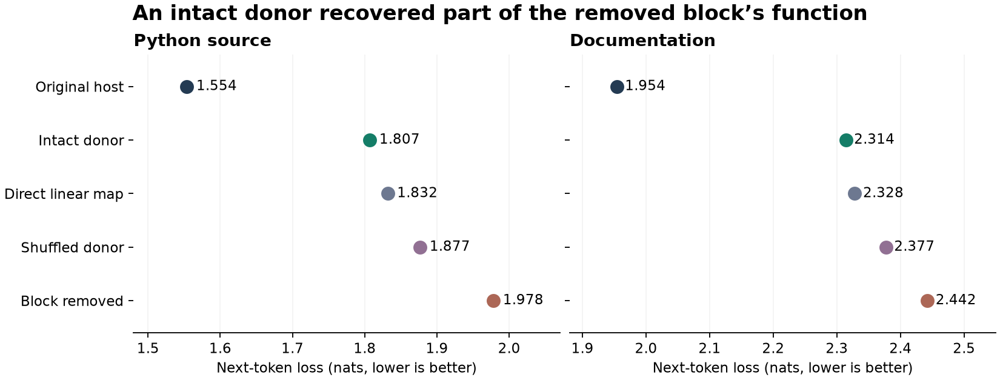

# Transplanting a frozen expert into Qwen

A 13.1M-weight feed-forward block from Qwen2.5-Coder-0.5B recovered **40.3% of the code loss increase** after removing the last feed-forward block from Qwen2.5-1.5B. The intact donor beat a shuffled donor on loss, but the original host stayed ahead and top-one accuracy did not beat the shuffle. A matched general-purpose donor was competitive.

[Paper and results](paper.md) · [Published Pubroot article](https://pubroot.com/ai/fine-tuning/replacing-a-qwen-feed-forward-block-with-a-smaller-pretrained-expert/) · [Decision log and plan](PLAN.md) · [Forced replacement data](results/forced/summary.json) · [Same-size donor comparison](results/donors/summary.json)



## Moving the graft one block earlier

The intact coding expert helped immediately in block 27. After we trained the entire following block, the cost of removing the expert on Python moved from 0.0553 to 0.0539 nats per token. The largest adaptation gain came when block 27 had no feed-forward output. [Study, figure and controls](penultimate/README.md) · [Methods](penultimate/METHODS.md)

## Task-trained Python repair

On a qualified infill task, the smaller coding donor solved 344/384 and the untouched larger host solved 111/384. All 273 new solves survived turning off the donor after task training. Every trained control also solved all 384. [Study and per-problem ledger](task_transfer/README.md)

## Semantic repairs and model routing

[Executable variable-binding study](semantic/README.md) compares model confidence, a partially informative test, and a two-model cascade on repairs for which all four candidates compile.

## Reproduce

Use Apple Silicon with a supported Metal GPU for the model runs. Install uv and start in this directory. The scripts fetch public, revision-pinned checkpoints and a CPython source archive. Model weights, corpus extracts and cached hidden states stay in the ignored cache directory. The public evidence includes the file/window manifests, selected epochs and per-token scores.

```sh
set -e
uv venv --python 3.12 .venv
uv pip install --python .venv/bin/python -r requirements.txt
.venv/bin/python prepare.py
.venv/bin/python run.py
.venv/bin/python forced.py
.venv/bin/python direct.py
.venv/bin/python compare_donors.py
.venv/bin/python verify.py
```

For CPU-only verification of the published scores, use `uv run --with numpy python verify.py`. Each panel has 2,048 target tokens per domain. Compare interventions within a panel. Only the mandatory replacement and same-size donor experiments remove the host block.

## Executable indentation repairs

The host chose four spaces for every repair. The smaller donor favored twelve and missed the discovery gate, 63/256 versus 64/256. [Paired programs, model choices and decision](indentation/README.md)

## Specializing the exact coding block proposed for transfer

Training the smaller model’s final feed-forward block gained 28–99 new repairs across three runs and lost 20–93 former solves. It trailed the adapted host on every qualification and test panel. [Specialist study, checkpoint release and per-repair reversion ledger](specialist/README.md)

## Recombining attention and expert weights inside the donor

Training the coding donor’s whole final block gained 0.13 percentage points over training its feed-forward module alone. A lookup using the four requested output counts solved 419/512 fresh repairs. [Whole-block comparison, shortcut and restoration ledger](donor_block/README.md)
