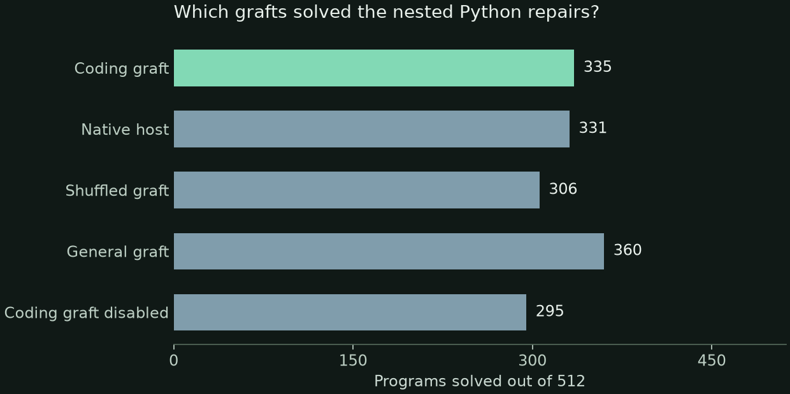

# Which new Python repairs disappear when a transplanted coding expert is switched off?

A smaller coding model solved all 256 repairs used to qualify a donor, while the larger host solved 119. We transplanted the donor's final feed-forward module into host block 27 and trained host block 28 on 16 examples. On 512 more deeply nested Python programs the coding graft solved 335 and the equally adapted native host solved 331. Disabling the donor erased 44 of 140 new solves relative to the untouched host. Seven of those 44 had also been missed by the adapted native host. A four-entry suffix-only lookup solved all 512 problems, limiting what the result establishes about syntax.

## Donor qualification and surgery

The Qwen2.5-Coder-0.5B donor and Qwen2.5-1.5B host received identical fill-in-the-middle prompts and chose one of four single-token repairs. A qualification win required a five-point donor lead with a positive paired bootstrap lower bound. The donor won 137 programs the host missed and lost zero. Its qualification advantage had a 95% interval of +47.7 to +59.8 percentage points. Qualification used nesting depths two and three. The independent evaluation used depths four through six, with twelve executable cases per program. [Registered protocol](PLAN.md) · [Generator](panels.py) · [Qualification evidence](results/qualification)

The frozen graft used the existing training-only linear bridges. Conditions included native, removed, direct affine, shuffled-neuron, general-purpose donor and intact coding donor paths. Only the final full host block trained. Every condition had the same 16 balanced examples drawn from the previous simpler generator, eight Adam updates, and learning rate 0.00002. A cached scoring check stopped an earlier job before training. We used the full model and full vocabulary to score every choice in the reported study. Native logits reproduced the original model exactly in the scoring audit. Model stitching motivates fitted interfaces, and fill-in-the-middle training provides the task format. [Model stitching](https://arxiv.org/abs/2106.07682) · [Fill-in-the-middle training](https://arxiv.org/abs/2207.14255) · [Qwen2.5-Coder report](https://arxiv.org/abs/2409.12186)

| Block 27 condition | Correct before fitting | Correct after fitting |
|---|---:|---:|
| Native | 237 | 331 |
| Feed-forward output removed | 222 | 247 |
| Direct affine replacement | 238 | 307 |
| Shuffled coding graft | 242 | 306 |
| General-purpose donor | 229 | 360 |
| Intact coding graft | 220 | 335 |

The coding graft gained four net solves over the adapted native control. Its paired advantage was +0.78 points [−2.34, +3.71]. Against the shuffled graft it gained +5.66 points [+3.71, +7.81]. The general-purpose donor had the highest count on this panel. The intervals resample programs from four shared code forms. There was one supervised training draw. [All candidate logits and comparisons](results/fit)

## Following individual repairs through the intervention

The 335 correct programs included 140 the untouched host missed. The graft also missed 42 originally correct repairs. Of the 140 new solves, 23 were also missed by the equally trained native host. Disabling the graft with the trained host held fixed lost 44 repairs and rescued four. All 44 losses came from the 140 new solves. Seven losses came from the stricter set of 23. Their IDs were nested-71977-34, -40, -125, -376, -395, -453 and -478, each with the same nested-71977 prefix. Substituting the shuffled expert in the trained recipient left 301 correct. The predefined promotion required ten strict donor-dependent repairs and a five-point advantage over both controls. It closed. [All lost IDs and audit](results/audit.json)

An exploratory control mapped each post-gap suffix in the qualification panel to its repair. Four distinct suffixes predicted all 512 primary outcomes with no access to the nested code. These data establish a causal contribution to particular model answers under this benchmark. They cannot identify parsing or stack tracking. A follow-up uses one identical suffix and changes only the opening byte in otherwise identical program triplets. [Opener follow-up](OPENER.md)

## Reproduction

The release includes all prompts, hidden cases, candidate logits, training IDs, bridge digest, receipts and intervention identities. From the repository root run `python nested_surgery/verify.py nested_surgery/results/qualification nested_surgery/results/fit` with NumPy to recompile the candidate programs and reconstruct the item-level changes. The environment used Python 3.12.16, MLX 0.32.4, MLX-LM 0.32.2 and NumPy 2.5.5 on the Apple M5 Ultra. The prior study supplies the pinned public model revisions and training-only interfaces. [Verification code](verify.py) · [Surgery code](run.py) · [Bridge construction](../penultimate/features.py)

The account owner proposed moving an expert one block earlier, adapting the following block, and measuring which newly correct answers disappear when the donor is removed. OpenAI Codex implemented the study, ran it over SSH on the owner's Studio, audited the outcomes and assisted with writing.

[Published Pubroot article](https://pubroot.com/ai/fine-tuning/which-new-python-repairs-disappear-when-a-transplanted-coding-expert-is-switched-off/) · [Submission and review](https://github.com/buildngrowsv/pubroot-website/issues/362)

On the registered identical-suffix follow-up the same coding graft solved zero of 256 complete counterfactual triplets. Its 243 correct individual completions were all closing parentheses. Disabling it lost 47 parentheses and gained 69 braces. This closes the planned syntax-transfer branch. [Follow-up and independent executable audit](opener_study/README.md)

## Fixed references and specialist qualification at 7B and 14B

- [Seven-block fixed reference](identifier_tunnel_study/README.md) preserves and reverses paired completions in both checkpoints.
- [Prompt-format control](opener_format_study/README.md) checks whether the donor's lead survives when the general model stops choosing colons.
- [Two-definition result](identifier_binding_study/README.md) shows how strongly the edit follows the selected class.
- [Cross-model feature transfer](identifier_transfer_study/README.md) reports the fitted interface from the 7B coder to the 14B model. [Cross-context follow-up](IDENTIFIER_TRANSFER_BINDING.md)
- [Cross-context transplant](identifier_transfer_binding_study/README.md) puts the donor's edit into either of two competing host classes.
- [Assignment-token wall](identifier_doorway_study/README.md) tests whether a single intermediate token can relay the edit. [Query-token follow-up](IDENTIFIER_QUERY_RELAY.md)
- [Computed integer result](computation_study/README.md) tests whether a declaration edit changes the result of arithmetic. [Cross-model operand result](numeric_transfer_study/README.md) · [Full-vocabulary result](numeric_open_study/README.md) · [Two-operand comparison](numeric_composition_study/README.md)
- [Direct and relayed paths](IDENTIFIER_ATTENTION_PATHS.md) restrict which later tokens can read an edited declaration.
- [Direct-edge attention wall](attention_paths_study/README.md) compares direct read access with unrestricted relay paths.
- [Qualified two-operand composition](numeric_simple_study/README.md) tests independent edits on simple sums and differences.
- [Direct-edge timing](attention_timing_study/README.md) isolates access before and after block 17.
- [Two operands without a shortlist](numeric_simple_open_study/README.md) verifies the complete-vocabulary result.
- [Single-block direct read](attention_single_study/README.md) tests the largest calibration score on a separate panel.
- [Complete-number composition](numeric_carry_study/README.md) verifies both directions of decimal carry with two donor edits.
- [One donor pass per operand](numeric_absolute_study/README.md) compares an absolute-state interface to the paired method.
- [Eight calibrated attention blocks](attention_sparse_study/README.md) compare two equal-size sets chosen in the same depth bins.
- [32B receiver comparison](numeric_scale_study/README.md) tests a newly fitted interface against the borrowed 14B direction at the same edit norm.
- [Numeric attention reuse](numeric_attention_study/README.md) tests the identifier masks on a transplanted operand and records the first-hop qualification.
- [Raw versus norm-matched 32B reuse](numeric_raw_32b_study/README.md) compares one edit direction at two magnitude rules.
- [Single-gain 32B transfer](numeric_scalar_study/README.md) uses native assignment-state differences to set edit magnitude without answers.

- [Two-operand transfer into 32B](numeric_carry_32b_study/README.md) measured complete carry answers under an unchanged borrowed gain.

- [Seven-block fixed reference at 32B](numeric_hold_32b_study/README.md) measures a fixed hold through the next seven blocks for both donor operands.
- [Operand alignment across widths](numeric_width_study/README.md) compares the same interface in a 5,120-wide 32B model and an 8,192-wide 72B model.
