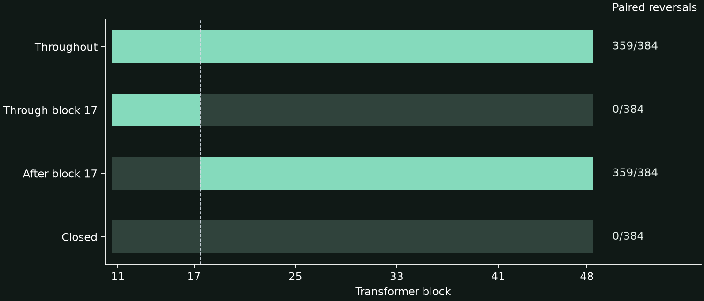

# Direct reads after block 17 reproduced every unrestricted reversal in Qwen2.5-14B

Allowing the final prediction token to read an edited declaration only in blocks 18–48 reproduced the unrestricted outcomes on **all 384** generated Python groups. Both schedules reversed the same **359 of 384** edited-class pairs. Opening the direct edge only in blocks 11–17 reversed zero. Every schedule preserved all four unedited answers on every group.

## How the attention edge changes

Each generated group includes two Python classes sharing an attribute spelling within a version. The second version changes the final letter of both attributes. Two queries select the earlier class or the other class. Each query ends at the partial attribute. The two permitted letters each fit a single token. CPython verifies that the correct ending returns the selected class's value and the other ending raises AttributeError. Native success requires both letter versions to predict the proper token in both queries. Reversal requires both versions of a query to prefer the other letter. [Executable task and direct-path result](../attention_paths_study/README.md) · [Timing registration](../IDENTIFIER_ATTENTION_TIMING.md)

The model is frozen Qwen2.5-14B base revision `97e1e76335b7017d8f67c08a19d103c0504298c9`. Fit the same 25 letter directions using 512 independent single-declaration pairs. At the earlier declaration after block 10, add the projection of its partner-minus-original hidden-state difference onto those directions. Leave all other states unchanged. Run four attention schedules for both original and edited sources. The only varying edge lets the final prediction token attend to that declaration. All other causal edges remain open in every layer. [Basis construction](../identifier_subspace.py) · [Mask schedules and scoring](../identifier_attention_timing.py)

| Direct edge available | Edited-class pairs reversed | Other-class pairs reversed | Edited-class original-letter margin, clean to edited |
|---|---:|---:|---:|
| Blocks 11–48 | 359 / 384 | 0 / 384 | +12.80 to −4.47 |
| Blocks 11–17 | 0 / 384 | 0 / 384 | +13.00 to +6.47 |
| Blocks 18–48 | 359 / 384 | 0 / 384 | +12.98 to −4.51 |
| Closed throughout | 0 / 384 | 0 / 384 | +13.17 to +6.65 |

The matched population contains all 384 fresh groups at indices 98000–98383. The late-minus-early reversal difference was +93.49 points (95% paired interval +91.15 to +95.83). The late and unrestricted runs had identical reversal outcomes at the group level, despite small differences in margins. The two windows have different lengths. This result shows that under the tested interventions, blocking the direct edge through block 17 leaves the subsequent window sufficient for the edit. It leaves the contribution of individual blocks and the exact time of the first consequential read open. [Margins, prompts and basis](results) · [Independent audit](verify.py) · [Audit output](audit.json) · [Single-block follow-up](../IDENTIFIER_SINGLE_EDGE.md)

Run `uv run --with numpy python nested_surgery/attention_timing_study/verify.py` to re-execute the saved programs and reconstruct the comparisons. The run took six minutes and 51 seconds using Python 3.12, MLX 0.32.4, MLX-LM 0.32.2 and NumPy 2.5.5 on the owner's Apple M5 Ultra. The account owner proposed walls that restrict communication in a network. OpenAI Codex designed and implemented the timing intervention, operated the Studio experiment, verified the counts and assisted with writing. [Execution receipt](results/receipt.json)

[Pubroot submission and review](https://github.com/buildngrowsv/pubroot-website/issues/459)
