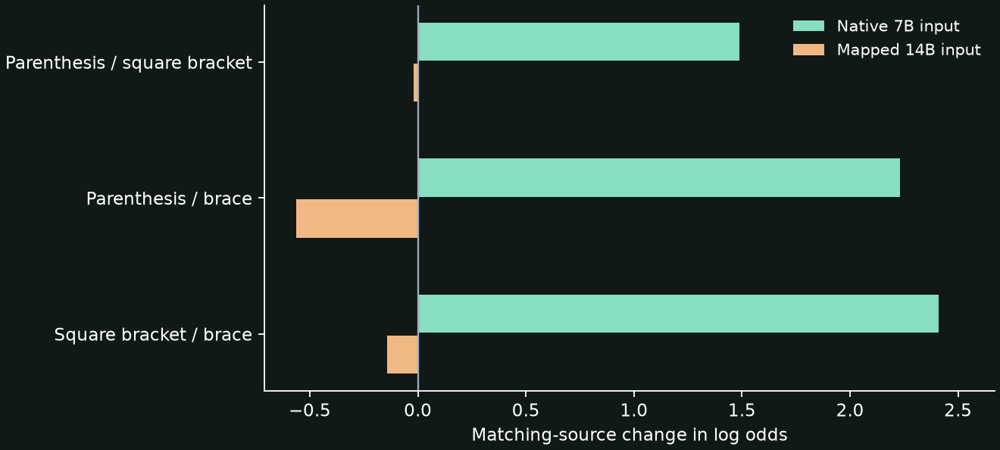

# A frozen input map reversed the bracket signal of a 7B coding expert on average

The smaller trained coder’s final feed-forward module contributed a positive 2.043 log-odds signal for the matching closing bracket when it read its own model’s state. When the same module read the 14B host through the original affine input map, the mean contribution was −0.242. We kept the 7B model’s residual stream and vocabulary readout in place. The effect therefore arose before the transplanted output could reach the 14B receiver. The result identifies one failure point in this interface.

## Cross the input source and destination

The earlier transplanted module yielded zero complete repair groups in the 14B host, while the full 7B coder on the same panel solved 54. An intervention in that coder found a strong effect in one bracket direction. Here we used a fresh 256-group panel. Within each group a program changed only one opening bracket, requiring a different closing token. We independently parsed the four allowed completions for each prompt. For each of the three destinations we applied the same module with each of the three source inputs. Its input either came from the native 7B state or from the 14B model’s block-27 state passed through the exact frozen input map used earlier. Everything outside that final module in the receiving 7B model retained the destination prompt’s native state. We measured four candidate logits per combination. Native matched-source scores agreed with the standard forward calculation on the eight preflight prompts. [Registered design](../BRIDGE_INPUT.md) · [Prior splice](../large_graft_study/README.md) · [Code](../bridge_input.py)

We held the destination constant. For a pair of candidate closing tokens A and B, we measured how much switching the input source from B to A moved the log odds of A versus B. This cancels any constant preference for one token. We averaged across the three destinations and bracket pairs and resampled whole program groups for 95% paired intervals. The native mean was +2.043 (1.984 to 2.102). The translated mean was −0.242 (−0.270 to −0.215). The translated mean minus half the native mean was −1.263 (−1.301 to −1.226), passing the prespecified criterion for attenuation.

| Opening characters contrasted | Native input | Translated host input |
|---|---:|---:|
| Parenthesis and square bracket | +1.488 | −0.020 |
| Parenthesis and brace | +2.231 | −0.564 |
| Square bracket and brace | +2.409 | −0.142 |

Matching each source to its destination, the original model solved 46 of 256 complete groups. Translated input solved 25 and zeroing the contribution solved 20. The destination still contains its own native residual information. These complete-group counts include that information. The crossed contrast measures which opener the module’s contribution favors. [Four-candidate scores, prompts and receipt](results) · [Independent reconstruction](verify.py) · [Recomputed effects](audit.json)

The experiment tests one affine calibration on one pair of pretrained models. The mapped input combines the host’s state and the frozen map, so the result leaves open whether the host state contains a recoverable signal and whether the output map also loses information. The next discriminating test fits input maps on independent matched code examples and compares the original and recalibrated maps before retraining any receiver. The owner proposed the transplant and causal tests. OpenAI Codex implemented and ran the experiment on the owner’s Apple M5 Ultra, audited its archives and assisted with writing.

[Pubroot submission and review](https://github.com/buildngrowsv/pubroot-website/issues/411) · [Recalibration protocol](../BRIDGE_CALIBRATION.md)
