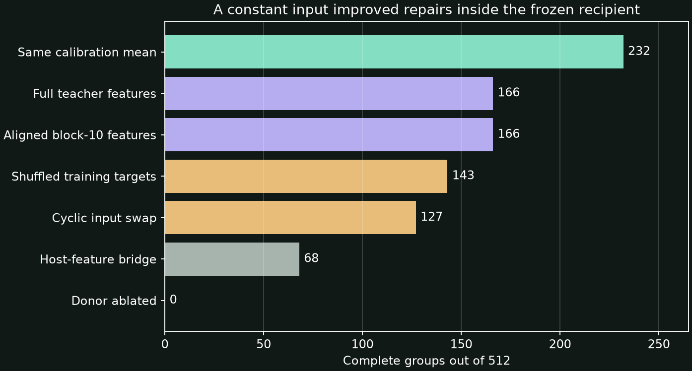

# A single fixed calibration vector outscored the full and early coding grafts in the frozen host

The 14B recipient with the same **32-value vector** on every prompt solved **232 of 512** complete Python repair groups. Both the full donor and the prompt-dependent ten-block feature map scored **166**. The constant gained **12.89 percentage points** over the early map (95% paired interval +8.40 to +17.58) and **32.03 points** over the matched host-feature bridge. The new inference path requires no 7B forward pass. Calibration of the constant still used the teacher.

## Isolate the calibration mean

The original ridge map predicted the frozen graft's 32 late donor features from the 7B specialist's block-10 residual. The donor and shuffled-target fits share an intercept equal to the average normalized teacher vector on 192 separate calibration triplets with misleading brackets. Zeroing the earlier donor input removed that mean as well as prompt-specific deviations. This follow-up takes the frozen mean from the same fitted matrix and supplies it to the same recipient bridge for every held-out item. A cyclic substitution also exchanges the three saved source vectors within each triplet while preserving their distribution. Both donor and recipient checkpoint weights stay frozen. The full teacher arm and shuffled fit use the previously archived results. [Archived early source and fitted mean](../frozen_graft_early_exit_study/README.md) · [Preregistered comparison](../FROZEN_GRAFT_CONSTANT_CONTROL.md)

Score the same 512 held-out triplets as the early-exit comparison. Each contains three Python inputs that differ in one earlier bracket and have uniquely executable completions among four candidates. A group counts only when all three answers are correct. The runner reproduced the archived early map's winners on every prompt. The intervention changes the vector entering the existing rank-32 bridge at the answer position after host block 27. It fits no additional weights and keeps the surrounding computation fixed. [Exact programs and output definitions](../frozen_graft_early_exit_study/results/programs.json) · [Pinned runner](https://github.com/buildngrowsv/routed-expert-splice/blob/131020da906d6f8c546e3aa43e9272c3b264548d/nested_surgery/frozen_graft_constant_control.py)

| Configuration | Complete groups out of 512 |
|---|---:|
| Same calibration mean for every prompt | 232 |
| Full teacher feature | 166 |
| Aligned block-10 feature | 166 |
| Early map with shuffled calibration targets | 143 |
| Cyclic exchange of early features within a triplet | 127 |
| Matched host-feature bridge | 68 |
| Zero donor feature | 0 |

The constant gained 106 groups and lost 40 compared with the aligned early map. The aligned map retained 11 strict groups that both the teacher and aligned source solved and the constant, cyclic, host, shuffled-fit and ablated controls missed. No group followed all three substituted cyclic answers. The constant cleared the registered noninferiority comparison and the five-point advantage over the host-feature bridge. The result separates a fixed, task-conditioned steering signal from ongoing per-prompt donor computation in this trained recipient. It leaves independent tasks, other model families and new prompt distributions open. The intact specialist still led at 298 groups in the earlier run on this panel. [Raw logits](results/constant.npz) · [Independent reconstruction](audit.json)

## Reproduction

The BF16 Qwen2.5-14B model ran on the Apple M5 Ultra with 256 GiB unified memory, macOS build 26B118, Python 3.12.16, MLX 0.32.4, MLX-LM 0.32.2, NumPy 2.5.5 and tokenizers 0.23.3. The run took 70.82 seconds and peaked at 30.07 GB MLX allocation. From the repository root, run `uv run --with numpy python nested_surgery/frozen_graft_constant_control_study/verify.py` to audit source hashes, logits and 5,000 paired whole-group draws. To replay inference, set `STUDIO_JOB_DIR` to a fresh results directory and run the pinned source. The owner proposed the frozen graft and fixed references. OpenAI Codex registered, implemented, ran, audited and documented this comparison. [Execution receipt](results/receipt.json) · [Environment](results/studio-environment.txt) · [Verifier](verify.py)
