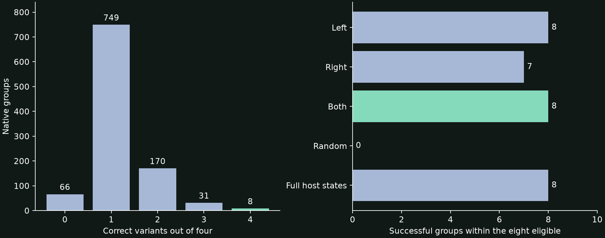

# A larger two-operand transplant test reached only eight clean programs in Qwen2.5-14B

The unmodified 14B host answered all four input variants correctly on **8 of 1,024** generated Python programs. On those eight, exchanging both operands from the 7B donor gave the expected answers on all four variants, while the matched random edits passed zero groups. The experiment required at least 100 clean groups, so the result is unresolved. Across all 4,096 untouched prompts the model ranked the correct answer strictly first 29.64% of the time among four allowed tokens.

## Task, controls and decision

Each group contains two Python assignments, and four variants from crossing two alternatives for each source. The function returns `left + 2 * right + constant` or `left - 2 * right + constant`. The prompt ends with an incomplete assertion about the function result. The four possible correct answers are distinct single-digit tokens. None is one of the four available operand values. The archived program verifier executes all four candidate completions in every host variant and identifies the unique correct one. [Registered protocol](../NUMERIC_COMPOSITION.md) · [Program generator and edit code](../identifier_numeric_composition.py)

Two separate donor programs return the operands directly. Each has its own identifier stem and surrounding code. Using the exact prior seven-coordinate map and source cut, translate the difference from each donor pair independently and inject each change at its own assignment after block 10 of the frozen Qwen2.5-14B host. The controls independently change the left operand or right operand, change both in orthogonal random directions of equal norm at both sites, and replace both full host states using the target program version. A group passes an arm only if all four predictions match that arm's counterfactual targets. Qualification requires all four native answers correct. [Prior map and model revisions](../numeric_transfer_study/README.md) · [Archived logits and programs](results)

| Intervention | Eligible groups succeeding |
|---|---:|
| Left operand only | 8 / 8 |
| Right operand only | 7 / 8 |
| Both independently translated operands | 8 / 8 |
| Random edits matched at both sites | 0 / 8 |
| Full host state at both sites | 8 / 8 |

Only one of the eight eligible groups used addition. Seven used subtraction. The bootstrap contrast is +100 points with identical endpoints within these eight groups. It cannot supply the missing native competence. The result supports a smaller qualification screen that keeps two independent operands and four answers, and removes multiplication and the constant. That screen checks native performance before permitting interventions. [Independent verifier](verify.py) · [Recomputed statistics](audit.json) · [Registered native qualification](../NUMERIC_TWO_OPERAND_QUALIFICATION.md)

Run `uv run --with numpy python nested_surgery/numeric_composition_study/verify.py` to reproduce the statistics and execute the saved programs. The 10-minute, 4-second run used Python 3.12, MLX 0.32.4, MLX-LM 0.32.2 and NumPy 2.5.5 on the owner's Apple M5 Ultra. The owner proposed expert transplantation and larger controlled tests. OpenAI Codex designed and implemented this comparison, ran and verified it and assisted with writing. [Execution receipt](results/receipt.json)

[Pubroot submission and review](https://github.com/buildngrowsv/pubroot-website/issues/449)
