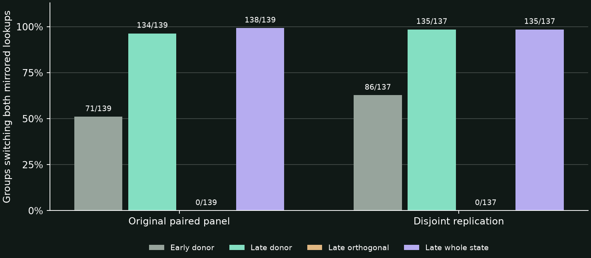

# The relocated dictionary key restored seven-coordinate steering on a fresh panel

With 256 fresh groups, the same seven-coordinate 7B donor redirected both mirrored dictionary lookups in **135 of 137** groups solved natively in both prompt orders when the key followed the dictionary. It redirected **86 of 137** when the key came first. The paired late-minus-early gain was **35.77 points** (95% interval +27.74 to +43.80). The late donor preserved all 137 constant-table answers. The late full-state swap also redirected 135 groups and the equal-norm orthogonal edit redirected zero.

## Confirm the placement effect on distinct programs

Each group uses two possible selector values. One prompt context assigns two associated dictionary values, one mirrors their assignment, and one gives both keys the same value. The function returns the selected value plus a signed offset. The two orders exchange only the lines that define the key and table. All expected answers are checked by executing the Python. The early and late versions of each group share the same keys, mappings and answer digits. A separate 7B function provides each donor numeral.

The early discovery panel used identifiers 169000–169255 and independently generated donor programs. This preregistered replication uses host identifiers 176000–176255 and a disjoint donor range beginning at 177000. The original same-panel study switched 71/139 groups at the early key and 134/139 at the late key. No fitting or adaptation uses the fresh test. [Preregistered fresh benchmark](../NUMERIC_LOOKUP_ORDER_FRESH_72B.md) · [Exact fresh programs](results/programs.json) · [Earlier same-panel comparison](../numeric_lookup_transfer_72b_study/README.md)

Use frozen BF16 Qwen2.5-Coder-7B and Qwen2.5-72B. Read the donor after six blocks and apply the same archived seven-coordinate interface at the recipient key after 17 blocks. If `h` is the 8,192-value recipient state and `c` the translated donor target, the edit is `h' = h + (c − ((h − μ)R + ν))Wᵀ`. Pre-cast Euclidean norm is matched for each orthogonal control. A full exchange replaces the entire key state with the paired program's state. Every expected next token must rank uniquely first over the full vocabulary. [Pinned runner](https://github.com/buildngrowsv/routed-expert-splice/blob/ad2451d54e4b6c70aa73749686402a0f317a4897/nested_surgery/identifier_lookup_order_fresh_72b.py) · [Original map](../numeric_absolute_study/results/map.npz) · [Frozen host matrices](../numeric_width_study/72b/alignment.npz)

## Whole-vocabulary outcomes on the shared cohort

The unedited checkpoint solved all six cases in 173 of 256 early-order groups and 155 late-order groups. The intervention table uses the 137 groups that qualified in both orders.

| Edit | Early mirrored switches | Late mirrored switches | Early constant preservation | Late constant preservation |
|---|---:|---:|---:|---:|
| Seven-coordinate donor | 86/137 | 135/137 | 136/137 | 137/137 |
| Entire key state | 88/137 | 135/137 | 136/137 | 137/137 |
| Equal-norm orthogonal | 0/137 | 0/137 | 137/137 | 137/137 |

The donor cleared all prespecified criteria for shared-group coverage, late switching, preservation and both paired improvements. For the two late active edits, one group switched only under the donor and one switched only under the whole-state exchange. Their paired rate difference was zero with a 95% interval of −2.19 to +2.19 points. The late donor gained 98.54 points over its orthogonal control (96.35 to 100.00). The confidence intervals resample complete groups in 5,000 draws. The result concerns controlled two-entry lookup prompts and known token sites. Changing declaration order alters both the key's prior context and the span until response. Those factors remain coupled in this replication. [Early raw ranks](results/early.npz) · [Late raw ranks](results/late.npz) · [Independent paired audit](audit.json) · [Matched-gap follow-up](../NUMERIC_LOOKUP_MATCHED_GAP_72B.md)

Run `uv run --with numpy python nested_surgery/numeric_lookup_fresh_72b_study/verify.py` from the repository root to execute the program assertions, audit the dataset split and frozen matrix hashes, and recompute all paired scores from the archived ranks. The Studio run took 802 seconds and peaked at 146.69 GB MLX allocation on Apple M5 Ultra with 80 GPU cores and 256 GiB unified memory. The runtime was macOS build 26B118, Python 3.12.16, MLX 0.32.4, MLX-LM 0.32.2, NumPy 2.5.5 and tokenizers 0.23.3. The owner proposed research on conditional routing and model transplantation, and OpenAI Codex implemented, ran, audited and documented the comparison. [Execution receipt](results/receipt.json) · [Independent verifier](verify.py)

[Pubroot submission and review](https://github.com/buildngrowsv/pubroot-website/issues/523)
