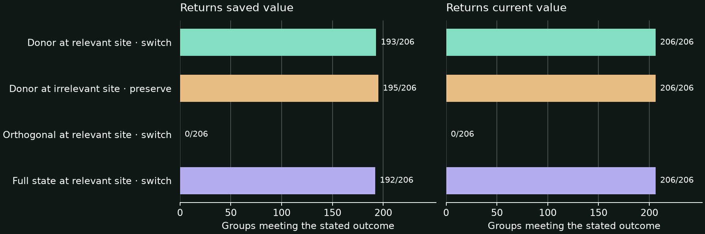

# A 7B transplant changed saved values at 72B and exposed interference from later overwrites

A seven-dimensional transplant into frozen Qwen2.5-72B switched all four correct answers in **193 of 206** paired groups involving a saved Python value and a later overwrite. A full-state exchange at the relevant assignment switched **192**, and an equal-norm orthogonal edit switched **zero**. Editing the irrelevant assignment preserved **195 of 206** groups (94.66%), one group short of the registered 95% floor. All 14 incorrect replies under the irrelevant-site edit gave the edited overwrite plus the offset. That error pattern was identified after the run.

## Save a value, overwrite the source, then choose what to return

Each Python function assigns an integer to a variable, copies it to a saved variable, executes three to five unrelated assignments, and overwrites the original variable. In one context the return statement reads the saved value and adds a fixed signed offset. In the other context it reads the current value and adds the same offset. A group combines two variants of the assigned digits with the two read contexts. The expected answers are distinct from all four assignment digits. The donor programs are independently generated single-variable functions. Python execution verifies both host and donor answers. [Registered protocol](../NUMERIC_SNAPSHOT_72B.md) · [Exact programs and edit sites](results/programs.json)

## Reuse the fitted interface

The frozen donor is Qwen2.5-Coder-7B, and the frozen recipient is Qwen2.5-72B, both BF16. The donor state after six blocks supplies seven translated coordinates through the existing affine map. The recipient edit occurs after 17 blocks at one assignment token. For recipient state `h` and translated donor coordinates `c`, the edit is `h' = h + (c − ((h − μ)R + ν)) Wᵀ`. The archived 72B matrices `R` and `W` read and write that coordinate system, with centers `μ` and `ν`. The narrow and orthogonal edits share the same pre-cast Euclidean norm at each compared site. A full-state control exchanges all 8,192 coordinates at the read assignment only. The experiment trains neither model and fits no new directions. [Pinned source](https://github.com/buildngrowsv/routed-expert-splice/blob/cf12ac324612d1779b7eeb6e380968474e5a337b/nested_surgery/identifier_numeric_select_72b.py) · [Frozen map](../numeric_absolute_study/results/map.npz) · [Frozen alignment](../numeric_width_study/72b/alignment.npz)

## Score both counterfactuals and both read contexts

The native model solved all four prompts in 51 of 64 qualification groups and 206 of 256 disjoint test groups. The table conditions on those 206 test groups. Each predicted answer must rank uniquely first over the full vocabulary. Both prompts in a context must yield the exact switched or preserved answer shown below.

| Intervention | Target behavior | Reads the saved value | Reads the current value | Both contexts |
|---|---|---:|---:|---:|
| Donor at relevant assignment | Switch | 193/206 | 206/206 | 193/206 |
| Donor at irrelevant assignment | Preserve | 195/206 | 206/206 | 195/206 |
| Orthogonal at relevant assignment | Switch | 0/206 | 0/206 | 0/206 |
| Full state at relevant assignment | Switch | 192/206 | 206/206 | 192/206 |

The donor exceeded the orthogonal control by 93.69 points, with a 95% paired interval of 90.29 to 96.60 points from 5,000 group bootstrap draws. All criteria except the irrelevant-site preservation floor passed. Under the earlier two-variable task with independent assignments, the same intervention preserved 246 of 250 paired groups. The panel and prompts differ, so that contrast is descriptive. [Earlier independent-assignment result](../numeric_select_72b_study/README.md) · [Scored ranks](results/selection.npz) · [Computed endpoints](audit.json)

The 11 preserved-value group failures were confined to edits of the later assignment while the program read the saved value. Within those groups, the top token in all 14 individual misses was the answer obtained from the edited overwrite. This is consistent with a later-value intrusion in this prompt format. The whole-state control was applied only at the relevant assignment. Whether a context-matched whole-state exchange at the overwrite causes the same errors remains open. The scope is arithmetic on saved bindings at known token locations in a frozen model. [Causal abstraction precedents](https://proceedings.neurips.cc/paper/2021/hash/4f5c422f4d49a5a807eda27434231040-Abstract.html)

Run `uv run --with numpy python nested_surgery/numeric_snapshot_72b_study/verify.py` from the repository root to execute and inspect the archived prompts, verify artifact hashes, check the perturbation size control and recompute the rank scores. The run took 732 seconds and reached 147.24 GB peak MLX allocation on an Apple M5 Ultra with 80 GPU cores and 256 GiB unified memory. It used macOS 27.2 (26B118), Python 3.12.16, MLX 0.32.4, MLX-LM 0.32.2, NumPy 2.5.5 and tokenizers 0.23.3. The owner proposed exploring fixed references at larger scales. OpenAI Codex designed and ran this comparison, verified the evidence and assisted with the writing. [Studio receipt](results/receipt.json) · [Independent verifier](verify.py)

[Published Pubroot article](https://pubroot.com/ai/nlp/a-7b-transplant-changed-saved-values-at-72b-and-exposed-interference-from-later-overwrites/) · [Submission and review](https://github.com/buildngrowsv/pubroot-website/issues/508) · [Completed context-matched whole-state test](../numeric_overwrite_72b_study/README.md)
