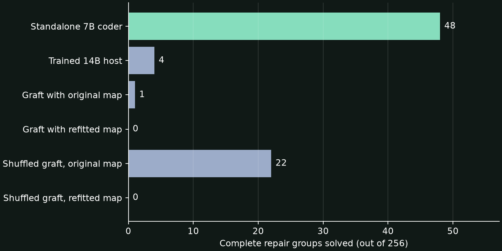

# Restoring a 7B expert’s input signal did not transfer complete repairs to its 14B host

A refitted affine input map had restored +2.040 matching-bracket log odds when a frozen 7B coding module ran inside its original network, close to +2.049 from native 7B input. Putting the same refitted input map and frozen module inside the 14B host produced **zero complete groups out of 256** after adaptation. The original map’s graft solved one, the equally trained native host solved four, and the 7B model by itself solved 48. Holding the trained receiver in place and turning off the expert lost zero groups. The local recovery was insufficient for this full-network transplant.

## Which boundary changed

The donor is Qwen/Qwen2.5-Coder-7B base at revision 0396a76181e127dfc13e5c5ec48a8cee09938b02. The host is Qwen/Qwen2.5-14B base at revision 97e1e76335b7017d8f67c08a19d103c0504298c9. The final block-28 feed-forward module of the 7B donor replaces the block-27 feed-forward module in the 48-block host. An affine transform maps host pre-module activations from 5,120 to 3,584 coordinates. A second affine transform maps the donor output to the host’s 5,120-coordinate stream, where it is added to the host residual. The original output map was fitted by ridge regression to approximate native host module outputs on 6,144 positions drawn from the CPython training split. It is held fixed here. [Donor checkpoint](https://huggingface.co/Qwen/Qwen2.5-Coder-7B/tree/0396a76181e127dfc13e5c5ec48a8cee09938b02) · [Host checkpoint](https://huggingface.co/Qwen/Qwen2.5-14B/tree/97e1e76335b7017d8f67c08a19d103c0504298c9) · [Calibration implementation](../large_graft.py)

The ordinary refit uses 1,536 independent calibration prompts at their final prediction positions, pairing unlabeled activations in the two frozen models. It minimized state error with an affine ridge fit and a 0.02 trace-normalized penalty. The earlier diagnostic held the donor’s own residual and vocabulary readout fixed and used this map at the prediction position. The transplant uses the refitted map at every position. The eight arms share the same initial block-28 weights and the same 16 supervised examples over eight full-batch Adam updates at 0.00002. The 275,268,608 parameters of block 28 alone receive gradients. All other host and donor weights stay frozen. The two shuffled controls use the same fixed permutation of the donor up-projection channels and share the original shuffled-output map. [Registered follow-up](../RECALIBRATED_GRAFT.md) · [Recalibration experiment](../bridge_calibration_study/README.md) · [Run code](../recalibrated_graft.py)

## The fresh panel

Each of 256 programs appears in three forms that differ by one opening bracket. A model earns a complete group only when it correctly closes all three. Each query presents the preceding text and following suffix and scores four candidate tokens. The two candidate tokens for other closing brackets and the colon are incorrect for that instance. We verified the unique valid completion with Python’s parser. The panel is disjoint from calibration and adaptation. [Evaluation prompts and fixed training IDs](results) · [Independent audit](verify.py)

| Module in the trained 14B host | Correct prompts / 768 | Complete groups / 256 |
|---|---:|---:|
| Native host module | 318 | 4 |
| Zero output | 269 | 0 |
| Affine approximation of native module | 241 | 1 |
| Shuffled coder, original map | 486 | 22 |
| Intact 7B general module | 172 | 0 |
| Intact 7B coder, original map | 261 | 1 |
| Shuffled coder, refitted map | 0 | 0 |
| Intact 7B coder, refitted map | 261 | 0 |
| Standalone 7B coder, no graft | 554 | 48 |

The refitted intact graft underperformed the equally trained native host by 1.56 points on complete groups (95% group-paired interval −3.13 to −0.39). It chose a colon on 502 prompts, compared with 506 for the original intact map and 450 for the trained native control. Its shuffled counterpart chose a colon on all 768. With the refit receiver held fixed, reinstating the original input map rescued three groups. Switching the transplanted output to zero, restoring the native module, or substituting the shuffled version solved zero groups and erased no previously solved groups. No group met the prespecified donor-dependence criterion. [Candidate scores, removal outcomes and receipt](results) · [Recomputed predictions and intervals](audit.json)

This is one model pair, calibration draw and receiver training budget. The refit was calibrated at one token position and used at all positions within the host. Both the changed context for downstream attention and the output translation remain possible contributors to the failure. The outcome closes adaptation around this transplanted module under these conditions. Python 3.12, MLX 0.32.4, MLX-LM 0.32.2 and NumPy 2.5.5 ran on the owner’s Apple M5 Ultra. The owner proposed the expert surgery and matched controls. OpenAI Codex implemented and ran the benchmark, verified the scores and assisted with writing.

[Pubroot submission and review](https://github.com/buildngrowsv/pubroot-website/issues/421)
