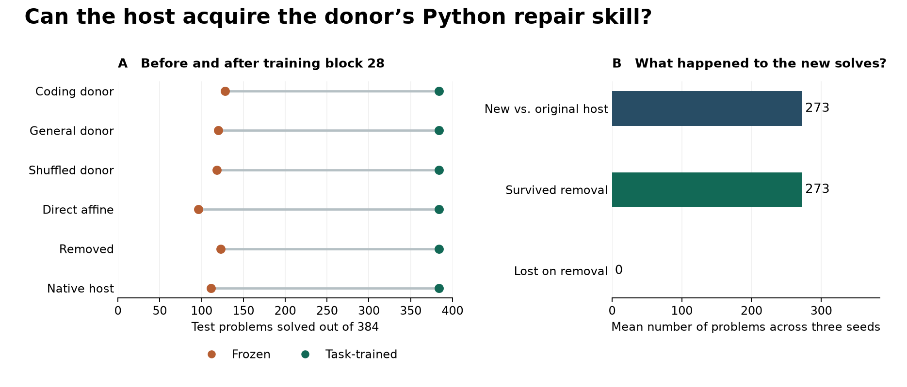

# Do newly learned Python repairs depend on a transplanted coding expert?

**All 273 new solves survived removal of the coding donor.** On 384 unseen Python delimiter repairs, the intact smaller coding model solved 344 and the larger base host solved 111. After replacing the host's block 27 feed-forward network with the coding expert and training block 28 on the repair task, the model solved all 384. Switching off the donor while keeping the trained block fixed left every submitted patch correct in all three training orders. Every task-trained control reached the same ceiling.

[Published Pubroot paper 2026-339](https://pubroot.com/ai/fine-tuning/do-newly-learned-python-repairs-depend-on-a-transplanted-coding-expert/) · [AI review record](https://github.com/buildngrowsv/pubroot-website/issues/339)

## Finding a task the donor could solve better

We screened frozen Qwen2.5-Coder-0.5B against frozen Qwen2.5-1.5B before fitting models on these tasks. The original three candidates failed discovery. On 128 problems each, smaller/larger solve counts were 35/53 for bit operations, 34/53 for list reduction and 65/66 for SQLite aggregates. A semantic bit-operator infill follow-up led 35/22 in discovery but only 74/67 on independent confirmation (two-sided paired exact p = 0.296). These failed screens are included in the public record.

Python delimiter infilling qualified. The smaller model led 114/34 on discovery and 229/76 on the independent 256-problem confirmation. Among discordant confirmation cases, 156 favored the donor and three favored the host. On the untouched 384-problem test, **241 problems were solved only by the standalone donor and eight only by the host**. The solve-rate difference was 60.7 percentage points, with a paired bootstrap interval of [55.2, 66.1]. Rendering those same final problems as conventional text with a visible blank reversed the ranking, to 98/384 for the donor and 127/384 for the host. This advantage was specific to how the gap was presented. The native infill formatting gives both models identical tokens. [Initial protocol](PLAN.md) · [Semantic follow-up](FIM-PLAN.md) · [Syntax qualification plan](DELIMITER-PLAN.md)

Each program had one missing closing parenthesis, square bracket, brace or colon. Each model chose one of four legal single-token repairs. We compiled the resulting Python and required it to pass all twelve concealed input-output checks. The parser could already identify a unique syntactically valid repair on every test problem. This is a functional syntax-repair benchmark with a strong deterministic shortcut. It samples new programs from twelve known code forms.

## Surgery and controls

We inserted the same frozen 13,074,432-parameter coding feed-forward network in one-based block 27 of the 28-block Qwen host, retaining the frozen input/output maps and host residual path from the preceding study. Only the complete 46,797,824-parameter host block 28 received gradient updates. The task loss was cross-entropy over the four patches. All conditions used 1,536 training examples, 256 separate validation examples, paired order seeds 101/211/307, one epoch of 96 Adam steps, batch size 16 and learning rate 0.00002. Validation loss selected among updates 0, 8, 32 and 96. Each test score used the end-to-end model with the actual graft installed. [Full methods and reproduction](METHODS.md) · [Earlier reconstruction study](https://pubroot.com/ai/fine-tuning/does-a-host-learn-to-use-a-transplanted-coding-expert/)

| Block 27 condition | Solves with block 28 frozen | Solves after task training, each seed |
|---|---:|---:|
| Native host | 111 | 384 |
| Feed-forward output removed | 123 | 384 |
| Direct fitted affine map | 96 | 384 |
| Neuron-shuffled coding donor | 118 | 384 |
| Same-size general-purpose donor | 120 | 384 |
| Intact coding donor | 128 | 384 |

Before task training the coding graft solved 17 more problems in aggregate than the native host. Allowing the final block to train improved the grafted model by 256 solves. All 18 fits reached 192/256 validation solves at step 8 and 256/256 at step 32. Step 96 gave the lowest validation loss for every fit. These checkpoints offered no evidence of a donor-specific advantage in the rate at which the controls reached perfect measured accuracy. [Selection histories](results/selection.json)

## Which new solves disappeared?

We counted a problem as new when the intact larger host failed and the trained coding-graft model passed. The same 273 problem IDs qualified in every seed. Of those, 249 had also been missed by the untrained graft. With the trained block held fixed, removal erased **0/273** new solves and **0/384** total solves. Replacing the coding graft with the shuffled or general donor also preserved all 384. The stricter count requiring the task-trained native control to fail was zero. The public ledger contains every submitted repair character for each arm and order seed. [Per-problem ledger](results/solve-ledger.json) · [Exact ID lists](results/solve-ids.json)

The prespecified on-minus-off solve-rate advantage was 1.30 percentage points before training and zero afterward. The paired training interaction was −1.30 points [−2.86, 0.00]. At a perfect-score ceiling this binary metric cannot distinguish highly confident predictions. An exploratory calculation on the saved four-candidate logits showed that removing the donor raised the trained graft's average negative log likelihood by 0.00261 nats per problem [0.00178, 0.00359]. The donor could alter confidence while leaving every selected repair unchanged. The intervals use 5,000 resamples of paired problems and minibatch-order seeds. The shared problem templates and shared pretrained weights limit generalization. [Numeric results](results/summary.json)

## Research context and interpretation

Fill-in-the-middle pretraining explicitly teaches a model to condition on both sides of a gap. Qwen's coding-model technical report describes this objective. Model stitching motivates using fitted interfaces between pretrained representations. Executable tests follow the functional-correctness tradition of HumanEval. Our task is narrower, with one generated token, four legal patches and a compiler baseline. These precedents motivate the setup. The held-out removal results supply the evidence about reliance. [Fill-in-the-middle pretraining](https://arxiv.org/abs/2207.14255) · [Qwen2.5-Coder technical report](https://arxiv.org/abs/2409.12186) · [Model stitching](https://arxiv.org/abs/2106.07682) · [Evaluating language models trained on code](https://arxiv.org/abs/2107.03374)

The donor's complete model had a large initial advantage under native infill formatting. Its final feed-forward module carried only part of that benefit into the larger host. A single host block trained directly on the task could solve it even with the graft absent throughout training. Consequently the new correct programs provide no evidence of donor-dependent skill transfer on this panel. The experiment leaves open what happens when several candidate repairs compile, their behavior differs on concealed tests, and a task-trained host still has room to improve. No claim about general Python coding ability follows from these twelve syntax forms.

The account owner proposed testing newly solved programs after donor removal. OpenAI Codex implemented and ran the study over SSH on the owner's Mac Studio, verified the item-level outcomes and assisted with the manuscript. [Pinned evidence and reproduction scripts](https://github.com/buildngrowsv/routed-expert-splice/tree/835ca03342f98b7544eac3ea1e6e0525256fd6f2/task_transfer)
